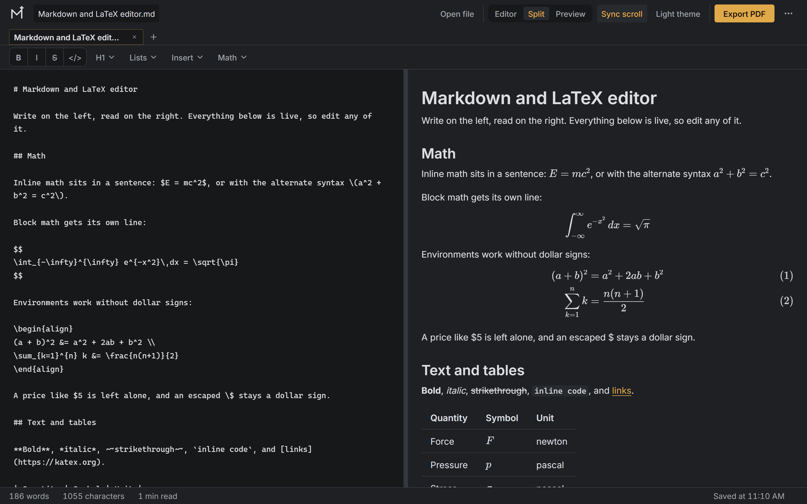

# Markdown and LaTeX Editor

A browser-based writing tool that renders Markdown and LaTeX side by side: type on the left, read the typeset result on the right. It solves the usual friction of writing technical notes — no build step, no server, no account, and no export pipeline that turns equations into images.

## Preview



## Features

- **Three view modes:** Editor, Split, and Preview, with a draggable divider that also moves from the keyboard (arrow keys, 2% steps, clamped to 20–80%) and persists between visits.
- **Document tabs:** several files open at once; each tab keeps its own text, name, caret, and scroll position. Tabs autosave to `localStorage` 500 ms after you stop typing and restore on reload. The strip scrolls sideways with the wheel and fades the edge that still has hidden tabs.
- **Automatic file naming:** the first `# Heading` names the file while it still carries a generated name; renaming by hand locks your name in place.
- **Two-way scroll sync** between editor and preview, toggleable and remembered.
- **Math:** inline `$x$` and `\(x\)`, display `$$…$$` and `\[…\]`, and LaTeX environments (`\begin{align}`, `equation`, `gather`, and their `*` variants). Rows without an alignment tab get one automatically at their first relation (`=`, `<`, `>`, `:`, `!`), so equations line up without typing `&`. `\vspace{2em}` produces real vertical space instead of being dropped. Rendering is KaTeX; a `$5` price and an escaped `\$` are left alone.
- **Markdown extras:** GFM tables, task lists, strikethrough, and fenced code with Prism highlighting (25 language components loaded on demand).
- **Sanitized output:** HTML passes through DOMPurify before it reaches the preview.
- **Formatting toolbar:** a joined `B` `I` `S` `</>` segment plus `H1 ▾`, `Lists ▾`, `Insert ▾`, and `Math ▾` menus. The heading trigger follows the caret (H1–H4 or paragraph); Math carries fraction, square root, summation, integral, matrix, and align-environment templates.
- **Find and replace:** match count, match case, `Enter` / `Shift+Enter` to step through results, `Ctrl+Enter` to replace all, `Esc` to close, and live re-matching as the document changes.
- **Keyboard shortcuts:** `Ctrl+B` / `Ctrl+I` / `Ctrl+K` for bold, italic, link; `Ctrl+S` download; `Ctrl+O` open; `Ctrl+F` find; `Ctrl+H` replace; `Ctrl+Alt+T` new tab; `Ctrl+Alt+W` close tab. `Enter` continues the current list.
- **Export:**
  - `.md` source download
  - standalone HTML with styles inlined
  - Word `.docx` with **native editable equations** — LaTeX goes Temml → MathML → OMML, so equations are double-click editable in Word, never screenshots
  - PDF through the browser's native print engine (`Save as PDF`): vector text, selectable math, no canvas and no rasterization
  - plain print
- **Paper sizes:** A4, Letter, Folio / Long, and Legal with a 20 mm margin, shared between the print `@page` rule and the DOCX section properties so both exports agree.
- **Print-aware output:** printing forces the light theme, shrinks unbreakable table content until it fits the page width, and stops display math from being clipped.
- **File input:** open `.md`, `.markdown`, `.mdown`, `.txt`, or `.tex` up to 5 MB, with a NUL-byte check that rejects binary files. Drag a file onto the workspace to open it; dropping several opens the first and says so.
- **Responsive header:** text labels on wide screens, icon-only at 800 px and below, with an overflow menu for Download, Export HTML, Export .docx, Print, and paper size. Status bar shows word count, character count, reading time, and save state.
- **Themes and motion:** dark and light themes that persist, a single amber accent driven entirely by tokens in `css/tokens.css`, self-hosted Bebas Neue (display) and Inter (body), and all animation disabled under `prefers-reduced-motion`.
- **Offline:** every library is vendored locally. The one network request is a Google Sans `@import` used only by the decorative blockquote quote mark.

## Tech Stack

- **Core:** vanilla JavaScript (ES2020+), HTML5, CSS3 — no framework, no bundler, no package manager, no build step.
- **Libraries** (all vendored under `vendor/`, no CDN except the quote-mark font):

  | Library | Version | Role |
  | :--- | :--- | :--- |
  | marked | 12.0.2 | Markdown → HTML |
  | DOMPurify | 3.1.6 | HTML sanitization |
  | KaTeX | 0.16.11 | Math rendering (JS, CSS, and 20 woff2 fonts) |
  | Prism | 1.29.0 | Syntax highlighting — core, autoloader, 25 components |
  | docx | 9.0.2 | Word document generation |
  | Temml | 0.10.29 | LaTeX → MathML for the DOCX path |
  | mathml2omml | 0.5.0 | MathML → OMML for the DOCX path |

- **Infrastructure / storage:** none. State lives in the browser's `localStorage` under `markdownLatexEditor.*.v1` keys (document, tabs, theme, split percent, view mode, scroll sync, paper size). Nothing is sent anywhere.

## Prerequisites

- A current browser. Minimums implied by what the code actually uses:

  | Browser | Minimum | Binding feature |
  | :--- | :--- | :--- |
  | Safari | **16.4** | Lookbehind regular expressions in the find and math patterns |
  | Chrome / Edge | **111** | `color-mix()` on the active tab (`:has()` needs 105, `String.replaceAll` 85) |
  | Firefox | **121** | `:has()` for task-list markers (`color-mix()` needs 113) |

  `text-wrap: balance` / `pretty` are decorative and degrade silently on older browsers.
- Optional: Node.js or Python 3, only if you want to serve the folder over HTTP.

## Installation & Usage

No install step — dependencies are vendored, so cloning is the whole setup.

```bash
git clone https://github.com/drnx64/md-latex.git
cd md-latex
```

Open `index.html` directly in a browser, or serve the folder:

```bash
npx serve .
python -m http.server 8000
```

Everything works from `file://` except **Export HTML**, which reads the `css/` files — browsers block that on `file://`. Serve over HTTP for that one action; otherwise it falls back to the stylesheets already loaded in the page.

## Project Structure

```text
├── index.html              Entry point: markup, sample document, script/style load order
├── css/
│   ├── tokens.css          Design tokens (color, type, spacing) and font faces
│   ├── base.css            Reset and element defaults
│   ├── app.css             Header, tabs, toolbar, menus, modal, status bar
│   ├── workspace.css       Editor/preview panes, divider, find panel
│   ├── markdown.css        Rendered document styles
│   └── export.css          Paper sizes and print rules
├── js/
│   ├── core.js             Shared namespace: constants, regex patterns, element lookups
│   ├── svg.js              Inline SVG icon set
│   ├── utils.js            Escaping, storage, notices, confirm modal, titles
│   ├── math.js             Math extraction, KaTeX rendering, auto-align, \vspace
│   ├── render.js           Parse → sanitize → restore, word/reading statistics
│   ├── documents.js        Tab strip, autosave/restore, file open, download
│   ├── export.js           Standalone HTML, print/PDF, @page rule, table fitting
│   ├── docx.js             Word export (Temml → MathML → OMML)
│   ├── editor.js           Textarea operations, formatting actions, shortcuts
│   ├── find.js             Find and replace panel
│   ├── layout.js           View modes, divider drag, scroll sync, drag-and-drop
│   └── app.js              Boot: preferences, event binding, menus
├── assets/
│   ├── favicon.svg         App mark
│   └── fonts/              Inter + Bebas Neue woff2 with their SIL OFL files
├── vendor/                 Third-party libraries, all local
│   ├── marked/             Markdown parsing
│   ├── dompurify/          HTML sanitization
│   ├── katex/              Math rendering: JS, CSS, 20 woff2 fonts
│   ├── prism/              Highlighting: core, autoloader, 25 components
│   └── word/               docx, temml, mathml2omml
└── docs/
    └── preview.png         Screenshot used above
```

Load order matters: `js/core.js` first, `js/app.js` last (see the comment in `index.html`).

## License

No license file is included in this repository, so no rights are granted by default.

Bundled fonts are licensed under the **SIL Open Font License 1.1** (`assets/fonts/LICENSE-Inter`, `assets/fonts/LICENSE-BebasNeue`). The libraries under `vendor/` remain under their upstream licenses — marked and KaTeX are MIT, DOMPurify is Apache-2.0/MPL-2.0, docx is MIT. License headers survive only where the minified build kept them, so check each project's own repository for the full terms.
